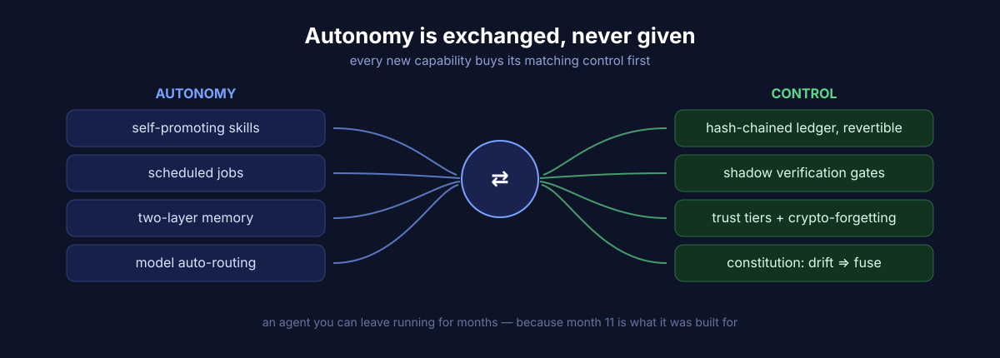
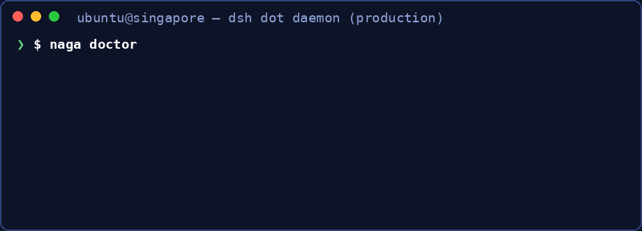
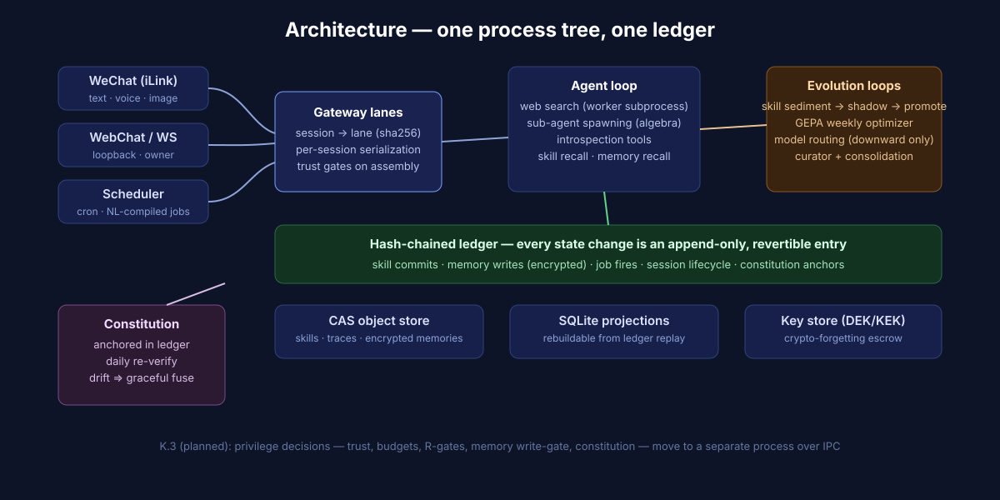

# DeepSeek Bot

[](https://github.com/vicfei/deepseek-bot/actions/workflows/ci.yml)

<p align="center"></p>

**跑在你聊天渠道里的个人智能体,为连续数月无人值守而设计——
每个动作都落进防篡改账本,可审计、可回滚。**

DeepSeek Bot 在微信(和本地 WebChat 控制台)应答,把经验沉淀为可复用技能,
并把**每一次**修改——无论作用于你的数据还是它自身——记为哈希链账本条目。
自主,不以失控为代价:


*(真实输出:一个活的 home、一条 sed 命令、历史被改了一个字节。)*

[English README](README.md)

## 有什么不一样

大多数智能体框架为演示效果优化。DeepSeek Bot 为之后的十一个月优化:当智能体修改了
自身状态、插件在凌晨三点崩溃、工具行为异常、或者你只是想要回昨天的系统时,
会发生什么?架构从内核层开始就围绕这些问题构建:

- **时间可组合性——一切修改皆可逆。** 任何状态变更都登记逆操作;系统可按
  LIFO 回滚到任意历史点,包括「回滚一次回滚」。效应有三种可审计形态
  (登记 / 执行 / 括号),全部入账。
- **空间可组合性——只声明、不接线。** 组件以反应式方式声明依赖与余效应,
  生命周期由运行时驱动;影子分支挂载不污染主系统。
- **汇流性是被测试验证的不变量。** 任意插件启停序列的静止态,等价于按依赖序
  一次性组合最终集合的状态——这不是愿景,而是经性质化测试、反例缩小锤炼过的
  内核性质。
- **拴着皮带的 RSI——分级授权下的递归自我改进。** 经验沉淀为带版本树的技能
  资产(Git 式内容寻址);晋升到全局作用域须过影子验证与 R 级授权。
  探索在分支,合并在闸门。(元改进层在 M4 落地。)
- **是账本,不是日志。** 追加式哈希链账本:Merkle 封存分段、快照、可随时从
  日志重建的 SQLite 投影。崩溃恢复经 1000 轮模糊测试取证——断写、中途崩溃、
  篡改,要么恢复要么响亮拒绝。
- **端到端的能力安全。** 对端派生信任级(owner / known / guest / untrusted);
  预算、工具可见性(R0 只读 … R4 不可逆破坏)、事件可见性由单一声明式表驱动
  执行——guest 可以使用智能体,但永远看不到写能力,也看不到别人的会话事件。
- **结构性崩溃隔离。** 外部来源插件在隔离的 worker 子进程中执行:段错误、
  挂死、内存泄漏都波及不到宿主;调用降级、worker 重建、任务继续。
- **真实渠道、真实媒体。** 内置微信个人号渠道(文本、正在输入、长文分段、
  图片本地解密 + CAS 存档 + 视觉识别、语音转写)与 WebChat 控制台——
  全部经同一个会话串行化网关路由。

## 架构

```
┌──────────────────────────────────────────────────────────┐
│ L3  元改进层(RSI 火种)                                    │
│     反思器 · 优化器 · R 级闸 · 影子验证                      │
├──────────────────────────────────────────────────────────┤
│ L2  经验资产层                                              │
│     技能库(版本树)· 记忆 · 保鲜                             │
├──────────────────────────────────────────────────────────┤
│ L1  执行层                                                  │
│     智能体回路 · 轨迹记录 · 并行会话                         │
├──────────────────────────────────────────────────────────┤
│ L0.5 接入平面                                               │
│     渠道 · 会话路由 · 车道队列 · 信任栈                      │
├──────────────────────────────────────────────────────────┤
│ L0  可组合内核                                              │
│     Context · 可逆效应 · 余效应 · 账本                       │
└──────────────────────────────────────────────────────────┘
```

内核强制的关键不变量(每条都有测试背书):

| # | 不变量 |
|---|---|
| INV-1 | 汇流性——任意启停序收敛到同一静止态 |
| INV-2 | 可逆性——可回滚到任意历史点,包括回滚本身 |
| INV-3 | 能力沿派生链单调递减 |
| INV-4 | 单写入者——共享状态只经串行账本变更 |
| INV-5 | 宪法运行时不可触达 |
| INV-6 | 模式棘轮——权限只自动降不自动升 |

## 姊妹项目

**[dsh-super-agent](https://github.com/vicfei/dsh-super-agent)** —— 给 CLI
编码智能体(Claude Code、Codex……)的准入控制、观察模式与工单。同一作者、
同一"信任优先"哲学,不同的战场:它守的是编码智能体的入口闸门,
本项目守的是个人智能体数月的运行时。

## 交易

<p align="center"></p>

## 渊源:DeepSeek Harness

本项目的架构 DNA——**时空可组合性**(可逆效应为时间轴、反应式余效应为
空间轴)、**一切皆插件**、每个插件皆可审视可替换——来自
[Cordis](https://github.com/cordiverse/cordis) 编程范式
([《时空可组合性编程范式》](https://arxiv.org/abs/2608.25512)),
并由 DeepSeek AI 的开源智能体框架
[**DeepSeek Harness**(`dsh`)](https://github.com/deepseek-ai/deepseek-harness)
率先落地于生产。

`DeepSeek Bot` 是该哲学的**独立 Python 路线后裔**,专注自进化个人智能体:
与 dsh(TS)零共享代码、非 fork、与 DeepSeek 及 `deepseek-ai` 组织无隶属。
dsh 是通用 agent 框架,DeepSeek Bot 则把同一套可组合性纪律押注在一个场景上——
一个能连续运行数月、带密码学遗忘的记忆、会排程、能晋升自身技能、
把安全规则锚进防篡改账本的个人智能体。

一等公民模型适配器是 DeepSeek(本项目就是伴着 deepseek 推理模型的
工程纪律长大的),名字也认这笔账:**一颗按 dsh 路数长成的 DeepSeek bot**。

## 状态

| 里程碑 | 范围 | 出口证据 |
|---|---|---|
| **M0——可组合内核** ✅ | Context、效应三形态、反应式余效应、持久账本、CAS、回滚 | 汇流性 PBT 5/5;崩溃恢复模糊(1000 轮零不一致);pyright strict;CI 全绿 |
| **M1——能跑** ✅ | LLM 适配器、智能体回路、技能沉淀/复用、WS 网关 + WebChat、轨迹与重放包 | 端到端对话、技能复用、重放包非空——全部真实 LLM 流量实证 |
| **M2——能连** ✅ | 微信渠道(文本/typing/媒体)、信任级降权、worker 隔离、热插拔 | 真实微信流量(含图片识别与语音);信任矩阵逐格测试;worker 崩溃穿透测试;bind→unbind→rebind 不重启 |
| **M3——能分身** ✅ | 子智能体派生器(授权代数:预算严格递减、工具子集、信任棘轮)、COW 会话分支、写捕获覆盖层 | 真实 deepseek 父任务派生两个并行子智能体(账本内轨迹交错);代数性质 PBT 钉死;百会话写捕获 SLO 达标 |
| **M4——能进化** ✅ | 晋升管道 + 影子验证 + R 闸、Curator、GEPA 周循环、重放保真度、模型自动路由、工作流编译 | main 上两个真实晋升技能(真实影子对打,其一省 69% tokens);一次完整真实 GEPA 循环(配额失败→归因→影子平局→R1 晋升);真实路由降档(3 影子胜→簇降档到预算模型,节省仪表盘在查);50 个真实稳定任务→deepseek 编译 9 节点 DAG→真实执行且 F.4 失败降级生效 |
| **M5——敢放手** 🔄 | 宪法层(账本锚定,漂移⇒优雅停机)、30 天 soak、安全自审 | 宪法已锚定(sha `6b6291d…`)且每日复验;soak 时钟 2026-10-15 起表→11-14 到期,**P0=0**;自审报告见 `docs/research/` |
| **记忆系统(§6.5)** ✅ | 情景+语义两层、信任写闸、投毒体检、DEK per-item/KEK per-subject 密码学遗忘、跨会话召回注入 | 真实流量:真实任务收尾提炼出加密记忆;下一任务召回命中(账本 `memory.use`);owner CLI 可解密;账本与 CAS 抽查零明文 |
| **定时任务(附录 C)** ✅ | 自然语言建 cron(一次 LLM 编译)、调度运行时、信任快照重校验(降级自动暂停)、misfire 语义、任务级 rCeiling 工具帽 | 真实流量:「每天早上七点给我科技新闻摘要」一次编译为 `0 7 * * *`;每分钟任务按点到点真实触发并留轨迹;账本写权归 daemon(CLI 走回环 WS) |

权威设计基线在 [`docs/design/`](docs/design/)(冻结 R3 资产,改动走 RFC);
研究笔记在 [`docs/research/`](docs/research/)。

## 快速开始

需要 Python 3.12+。

```bash
git clone https://github.com/vicfei/deepseek-bot.git
cd deepseek-bot
python3 -m venv .venv && .venv/bin/pip install -e ".[dev]"

.venv/bin/pytest -q                    # 全量测试(单元 + PBT + 模糊 + 渠道)
.venv/bin/ruff check src tests         # lint
.venv/bin/pyright src                  # strict 类型检查
```

或从 PyPI 安装:

```bash
pip install deepseek-bot          # 正式发布版
# 或直装 git 版: pip install git+https://github.com/vicfei/deepseek-bot.git
```

运行 daemon(回环网关 + 微信渠道)另需凭据文件
`~/.deepseek-bot/credentials/providers.json`(0600)——期望的供应商条目见
`src/deepseek_bot/llm.py`。(存量 `~/.naga` 目录自动沿用,无需迁移。)

```bash
deepseek-bot daemon start      # http://127.0.0.1:18789 —— WebChat 控制台
deepseek-bot doctor            # 自检
```

## 试用

daemon 起来之后:

1. **WebChat** —— 打开 <http://127.0.0.1:18789> 直接对话(回环连接即
   owner 信任)。
2. **微信** —— 在同一页面点 **📱 绑定微信**,用微信扫码,联系人里就会
   出现 bot——文本、语音(自动转写)、图片全链路可用。绑定热生效,无需
   重启。

**支持多人吗?** 支持——每人扫各自的码,平台给每个绑定者分配**独立的
bot 身份**,会话、记忆、信任按用户隔离;生产上已验证两位用户并发使用。
注意当前定位是*个人/小圈子部署*:新扫码绑定在你的实例上会被授予
**owner** 信任,WebChat 控制台按设计仅回环可达——向陌生人开放实例前,
请先读 `docs/design/` 的信任模型。



*(每一行都是生产 daemon 的真实输出——自 2026-10-15 起无人值守连续运行。)*

## 架构

<p align="center"></p>

## 仓库布局

```
src/deepseek_bot/
  kernel.py        # L0 种子内核(冻结基线孪生;原位演进走 RFC)
  ledger_store.py  # 持久账本:追加日志、Merkle 封存、快照、CAS、SQLite 投影
  gateway.py       # WS 网关:车道队列、信任策略、事件可见性矩阵
  agent.py         # 智能体回路(轨迹 + 技能沉淀)
  skills.py        # 版本树技能库(内容寻址)
  trust.py         # 对端信任派生(allowlist + 渠道默认)
  worker.py        # 外部来源插件的子进程隔离
  wechat.py        # 微信 iLink 渠道:轮询、typing、分段、媒体、视觉识别
  daemon.py cli.py # 运行时宿主与 CLI
docs/design/       # 冻结设计基线(四份文档 + spec-constants + 检查器)
docs/research/     # 研究笔记与 RFC 素材
tests/             # 单元、性质化、崩溃模糊、渠道与集成套件
```

## 参与贡献

issue 与 PR 使用**英文**(公开工件的工作语言;讨论中中英均可)。
变更流程:issue → 分支 → PR → CI(ruff / pyright strict / pytest /
冻结检查器)→ merge commit。`docs/design/` 下的冻结基线不做原位编辑——
改动走 RFC(格式参考 `docs/research/rfc-m2-registry-addendum.md`)。

## 许可证

[MIT](LICENSE) © 2026 vicfei
